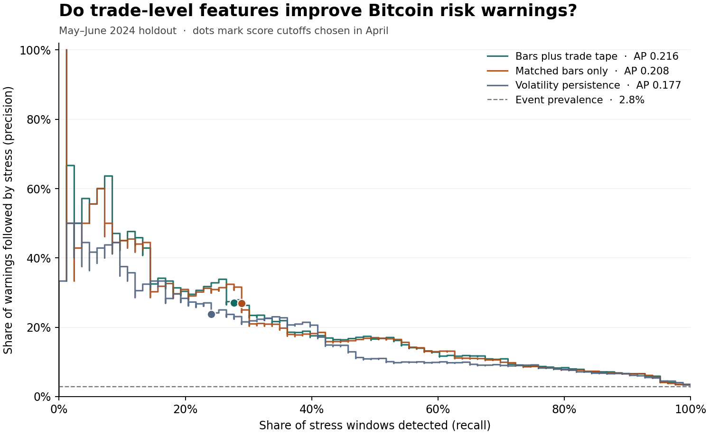

# Half-Hour Risk

**Can the distribution of large, aggressive Bitcoin trades help a risk desk anticipate an unusually volatile half-hour?**

A quantitative finance end-semester project using **243,917,258 Binance BTC/USDT spot aggregate trades**, six months of BTC and ETH minute bars, Apache Spark MLlib and Structured Streaming. At every UTC half-hour boundary, the model scores the next thirty minutes for unusual realized variance. The matched comparison tests whether trade-level information buys a better warning than ordinary bars alone. [Project brief](whatthis.md)

The tape model scored **0.2162 average precision** on May–June, compared with **0.2076** for the same logistic model using bars alone and **0.1772** for volatility persistence. With cutoffs fixed in April, the tape model caught 23 of 83 stress windows and raised 62 false alarms. Bars alone caught 24 and raised 65 false alarms. [Results and uncertainty](report.md)



## Read the project

| Document | What it answers |
| --- | --- |
| [Technical report](report.md) | What was measured, which model performed best and how much the tape added |
| [Project brief](whatthis.md) | Business decision, novelty, limits and mapping to all 30 assessment marks |
| [Literature](literature.md) | Closest Bitcoin volatility studies and the research gap |
| [Final datasets](datasets.md) | Exact dates, row counts, fields, download links and publisher checksums |
| [Experiment plan](plan.md) | Frozen train/validation/test periods, label, ablation and alert policy |
| [Architecture](architecture.md) | Spark data flow, event clock and feature equations |
| [Engineering](engineering.md) | Reproduction commands, quality rules, scalability and streaming |
| [Progress](progress.md) | Completed milestones and supporting evidence |
| [Viva walkthrough](viva.md) | Five-minute demonstration and likely examiner questions |

## Run the demonstration

Install a Java 17 JDK, Python 3.11 and uv. From the repository root, run the commands below. The demonstration loads the small published Spark pipeline and re-scores two held-out cases. The full source archives are required only for rebuilding the study. [Full reproduction](engineering.md)

```bash
uv venv --python 3.11
uv pip install -r requirements.txt
scripts/run demo
```
