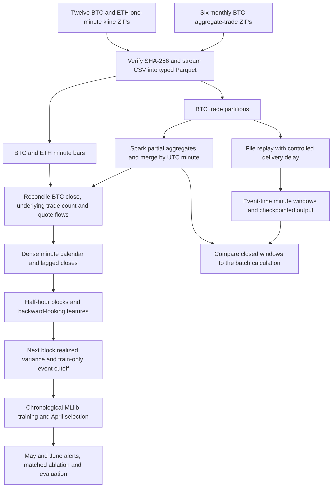

# System architecture

The large computation is reducing Bitcoin executions to additive statistics. On the other side of that reduction there are only 48 forecast decisions per UTC day. Spark handles the trade scan, joins, time windows and model fitting. The driver can then score a few thousand ordered predictions exactly, including score ties and paired resampling.

## The data at each boundary

| Stage | Key and grain | Operations and invariant |
| --- | --- | --- |
| Archive | Product × symbol × month | Verify the exchange digest and the pinned snapshot. Decompress one CSV as a stream and encode typed Parquet row groups. |
| Trade tape | BTC aggregate trade ID | Check increasing IDs across chunks and monthly boundaries. Enforce valid trade fields and UTC source month. Multiple simultaneous trades retain distinct IDs. |
| Minute statistics | UTC epoch minute | Map each print to quote notional and aggressor sign. Locally combine associative sums before the shuffle, then merge by minute. Break equal-time closing-price ties using aggregate trade ID. |
| Reconciled minutes | UTC calendar minute | Compare tape with the publisher's BTC close, fill count, quote volume and buy quote volume. Join ETH on the exact minute. A one-minute shifted join supplies the previous close. |
| Block statistics | UTC half-hour | Aggregate the thirty minute returns and sufficient statistics. Count valid observations. Set feature and target eligibility from those counts. |
| Decision table | Forecast issue time | Compute multi-horizon trailing features. Attach the following block's realized variance as the outcome. Fit thresholds on January–March. |
| Serving simulation | Historical event timestamp | Read micro-batch files by synthetic delivery time, window by exchange event time, checkpoint progress and append closed windows. |

## Time alignment at 14:00 UTC

| Quantity | Evidence window |
| --- | --- |
| Trade concentration and BTC/ETH flow | 13:30 up to 14:00 |
| Last BTC realized variance | Thirty returns ending at the closes of minutes 13:30 through 13:59 |
| Six-hour and day context | Twelve and 48 completed half-hour blocks, including 13:30–14:00 |
| Future outcome | Thirty returns ending at the closes of minutes 14:00 through 14:29 |
| Earliest time to know the outcome | 14:30, assuming prompt trade and final-bar delivery |

An event timestamped exactly 14:00:00.000 belongs to the target block. The final close of the 13:59 bar is both a historical observation and the starting price for the first future return. The model never receives the 14:00 bar as an input to this decision. A regression test changes the future block and checks that every model feature is identical.

## Trade calculations

For aggregate print i, let xᵢ = price × base quantity in USDT. Set sᵢ to +1 for a taker buy and −1 for a taker sell. Binance's buyer-maker flag is true on a taker sell. For each half-hour compute N, V = Σxᵢ, Q = Σxᵢ² and S = Σsᵢxᵢ² by merging minute sums.

| Added feature | Definition | Interpretation |
| --- | --- | --- |
| Size concentration | log(NQ / V²) | Zero for identical print sizes. A small number of outsized prints raise it. The N factor controls for mechanical concentration changes with activity. |
| Squared-size signed imbalance | S / Q | Net aggressor direction with extra weight on large prints, bounded between −1 and +1. |
| Imbalance gap | Absolute difference between S/Q and ordinary signed quote-volume share | Measures how much large-print direction differs from the usual bar-level signal. |

The bars-only control includes BTC log variance over 30 minutes, six hours and 24 hours, absolute net log return, quote volume, count and taker imbalance. ETH contributes short-horizon variance, absolute return, quote volume and taker imbalance. A normalized BTC–ETH return cross-product measures contemporaneous co-movement. UTC clock and weekend features use the known issue time. [Feature implementation](risklab/panel.py)

## From raw records to a warning

At the requested issue time, the prediction command limits both bar feeds and the trade tape to timestamps strictly before the boundary. The batch study and the forecast command share the same function for past features. Training joins future realized variance to those features by the exact issue-time key. Prediction passes the features directly to the published Spark pipeline and compares its output with the frozen validation cutoff. [Implementation](risklab/predict.py)

## Where the work runs

The monthly ZIP is a transport format with limited parallel scan options. Arrow converts each archive in bounded batches. Spark splits Parquet input across tasks. The minute aggregation has one narrow integer grouping key, and the thirty-minute grouping shrinks the data again. Only then does a single ordered window compute long lookbacks. Increasing executor count would not benefit that final small window much. The measured local timings and their interpretation belong in the [technical report](report.md).

The streaming branch demonstrates sufficient-statistic parity and checkpoint recovery. It emits windows after a two-minute watermark. A live risk service issuing at exactly :00 or :30 would also need provisional aggregates by deadline and explicit correction handling for late prints. The model experiment assumes prompt exchange delivery. [Spark Structured Streaming](https://spark.apache.org/docs/3.5.3/structured-streaming-programming-guide.html)
