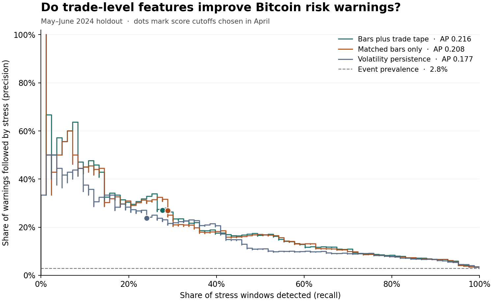

# Half-Hour Risk

*An empirical study of BTC/USDT spot volatility using Apache Spark*

The trade tape modestly improved the **ranking** of future BTC stress windows. On 2,928 unseen half-hours, the tape-enhanced logistic model achieved **0.2162 average precision**, against **0.2076** for its matched bars-only model and **0.1772** for volatility persistence. At the April-calibrated alert cutoffs, the tape model raised 85 warnings, caught 23 of 83 events and generated 62 false alarms. Bars alone caught one additional event and generated three additional false alarms. [Held-out results](results/holdout.json)

## Research design

A risk analyst observing the market at time t wants a warning before an unusually volatile 30-minute interval. Volatility persistence is a strong alternative explanation for a successful warning. Ordinary Binance bars also reveal quote volume, underlying trade count and the share initiated by buyers. The test asks whether a much more expensive source, the aggregate-trade tape, adds warning value over those controls and contemporaneous Ethereum conditions. Earlier Bitcoin research used book and order-flow information at other horizons and in other instruments. [Literature review](literature.md)

**Outcome.** Let Cₘ be the BTC close in UTC minute m. For a target half-hour beginning at t, realized variance is the sum of [log(Cₘ/Cₘ₋₁)]² over its 30 minutes. A stress event exceeds the 90th percentile of this measure in January–March training data. Adjacent targets meet at the boundary. Each forecast uses only prior completed blocks, with the immediately preceding close supplying the starting price. The unit is squared log return and the measure is unannualized.

**Comparison.** Spark MLlib fitted eight pipelines comprising two feature sets, two estimator families and two settings per family. The 15 control features cover BTC volatility history, price change, activity, signed quote flow, ETH conditions and the UTC clock. The 18-feature model adds three trade-size moments. April average precision selects model settings. To attribute differences to the feature group, the main comparison holds model family, parameter, training observations and test timestamps constant. A separately optimized bars-only model and a raw persistence score supply further references. [Frozen protocol](plan.md) · [Feature equations](architecture.md)

**Operational rule.** Each candidate has its own April score cutoff. A warning fires only above the higher empirical 90th percentile of its April scores. A constant probability ranking would achieve average precision equal to the test event fraction. Precision counts the successes among warnings and recall counts the identified events among all stress windows. False warnings per day translate the score threshold into monitoring workload.

## Data and leakage controls

| Evidence | Measured quantity |
| --- | ---: |
| Source BTC aggregate trades | 243,917,258 |
| Underlying fills represented | 311,557,031 |
| Source BTC minutes / ETH minutes | 262,080 / 262,080 |
| BTC minutes agreeing on close, count and quote flows | 262,080 |
| January–March training examples after warm-up | 4,319 |
| April validation examples | 1,440 |
| May–June held-out examples | 2,928 |

The audit found continuous aggregate IDs, unique UTC minute keys in both bar series and a complete BTC reconciliation. Past features and future labels share an issue-time key. Tests inject a future shock and remove a target return to verify that feature vectors stay fixed and incomplete targets drop out. All comparisons use the same eligible timestamps. [Source snapshot](sources/manifest.json) · [Quality results](results/data_quality.json) · [Tests](tests/test_study.py)

## Selection and held-out results

The training cutoff was **0.0000428136** in half-hour realized variance, equivalent to a square root of 0.6543% in unannualized realized volatility. There were 432 events among 4,319 training windows (10.00%), 142 among 1,440 validation windows (9.86%), and 83 among 2,928 test windows (2.83%). A fixed historical cutoff made an unusually quiet test period visible. Recomputing the cutoff on May and June would have erased that change.

April selected L2 regularization 0.01 for both logistic models and depth 2 for both tree models. The bars-only logistic fit had slightly higher validation AP than the tape logistic fit. The sign of the matched difference reversed in the test period. The following are results of the four selected configurations and the prespecified baseline. [All eight validation fits](results/validation.json)

| Model | April AP | Test AP | Alerts | Events found / 83 | False alerts per day | Precision | Brier |
| --- | ---: | ---: | ---: | ---: | ---: | ---: | ---: |
| Previous 30-minute variance | 0.5124 | 0.1772 | 84 | 20 | 1.05 | 23.8% | — |
| Bars, logistic | 0.5190 | 0.2076 | 89 | 24 | 1.07 | 27.0% | 0.02826 |
| Bars + tape, logistic | 0.5183 | **0.2162** | 85 | 23 | **1.02** | 27.1% | **0.02794** |
| Bars, boosted trees | 0.4957 | 0.1991 | 84 | 21 | 1.03 | 25.0% | 0.03006 |
| Bars + tape, boosted trees | 0.4953 | 0.2160 | 86 | 20 | 1.08 | 23.3% | 0.03000 |

**Uncertainty.** The paired logistic AP increment was **+0.00863**. The 95% percentile interval from 2,000 paired resamples of the 61 UTC days was **+0.000005 to +0.01894**. Its lower end is effectively zero. The estimate supports a small ranking gain during this holdout. Sixty-one days on one venue provide limited evidence about its persistence in another market regime. [Per-window predictions](results/forecasts.csv.gz) · [Bootstrap and slice results](results/holdout.json)

**Regimes.** The calm slice, defined by trailing 24-hour variance at issue time, contained 41 events in 2,265 windows. Tape and matched bars scored AP 0.1371 and 0.1333 there. The active slice contained 42 events in just 663 windows, with corresponding APs of 0.2992 and 0.2864. Prevalence differs across slices, so compare model pairs within a slice.

## Two decisions from the test set

| Forecast issue in UTC | Tape score | April cutoff | Eventual realized variance | Decision and outcome |
| --- | ---: | ---: | ---: | --- |
| May 1, 07:30 | 0.9790 | 0.3012 | 0.00016167 | The first held-out warning correctly flagged the 07:30–08:00 interval. The preceding half-hour was already stressed. |
| May 15, 12:30 | 0.0339 | 0.3012 | 0.00037017 | The largest missed event followed a preceding half-hour below the stress threshold. The model assigned this window a low probability. |

These examples illustrate persistence and the difficulty of anticipating a sudden change. Each case includes all input values and can be re-scored by loading the published model. [Cases](results/case_studies.json) · [MLlib model](results/selected-model.zip)

## Streaming verification

The 11 January replay passed **314,003** real aggregate trades through Spark Structured Streaming. A deterministic delay sent **2,959** events to a later delivery batch. In the 60 minutes evaluated, all **304,952** prints reconciled to the original batch aggregation. Counts and closing prices agreed exactly, and the largest scaled error in the floating moments was 2.085 × 10⁻¹⁴. The three query starts consumed 99,751, 214,252 and zero input rows, respectively. A three-minute buffer allowed the final evaluated window to close. [Checkpoint and watermark evidence](results/streaming.json)

## Interpretation limits

- The study covers one centralized spot market, one target asset and six months. BTC and ETH bars come from the same venue. Both assets can respond to the same market event. Their association does not identify a cause.
- Squared notional depends on Binance's grouping of same-price executions for a taker order. Underlying fill count is available in bars. The number and size distribution of aggregate prints can still differ. The matched ablation estimates the value of the three features together.
- A score measures the chance of crossing one historical realized-variance cutoff. Its event frequency can change with market conditions. A directional forecast, a liquidation and an executable trading return are different outcomes.
- Retrospective scores assume the inputs arrive by the issue time. The controlled replay tests correctness under a known delay. Live availability would need independent timing measurements.
